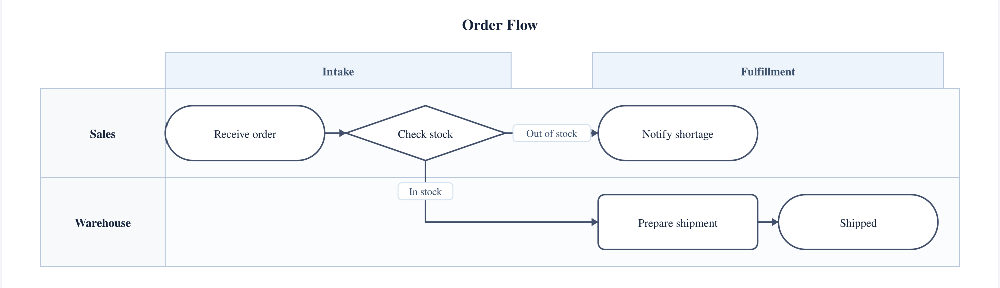

# Swimlane Diagram Preview

**English** | [日本語](./README.md)

A VS Code extension that renders ` ```swimlane ` fenced code blocks as swimlane diagrams directly inside the built-in Markdown preview — the same feeling as Mermaid code blocks turning into diagrams in the standard preview.



The diagram above is produced from a code block like this:

```swimlane
swimlane
    title "Order Flow"
    direction LR

    lane sales "Sales"
    lane wh "Warehouse"

    phase p1 "Intake"
    phase p2 "Fulfillment"

    node s1 "Receive order" lane=sales phase=p1 shape=start
    node s2 "Check stock" lane=sales phase=p1 shape=decision
    node w1 "Prepare shipment" lane=wh phase=p2
    node w2 "Shipped" lane=wh phase=p2 shape=end
    node s3 "Notify shortage" lane=sales phase=p2 shape=end

    s1 -> s2
    s2 -> w1 "In stock"
    s2 -> s3 "Out of stock"
    w1 -> w2
```

## Usage

1. Install this extension
2. In a Markdown file (`.md`), write `.swim` code inside a ` ```swimlane ` fence
3. Open the preview (`Ctrl+Shift+V` / `Cmd+Shift+V`) — the diagram renders in place

The quickest way to try it is to paste the following straight into a `.md` file:

```markdown
​```swimlane
swimlane
    title "Example"
    direction LR

    lane you "You"
    node n1 "Write a ```swimlane block" lane=you shape=start
    node n2 "Open the preview (Ctrl+Shift+V)" lane=you
    node n3 "See the diagram" lane=you shape=end

    n1 -> n2
    n2 -> n3
​```
```

If there's a syntax error, the preview shows the error message (with the offending line number) instead of the diagram.

If writing it by hand is tedious, you can assemble the diagram in [Swimlane GUI Studio](https://tossie85.site/tools/swimlane-gui-studio.html), export the `.swim` code, and paste it in.

## `.swim` syntax

`.swim` is a simple line-based notation. Leading/trailing whitespace on each line is ignored.

- `swimlane` — a marker on the first line (parsing works the same with or without it)
- `# comment` — lines starting with `#` are ignored as comments
- `title "Title"` — the diagram's title (optional)
- `direction LR` / `direction TB` — diagram orientation. `TD` is accepted as an alias for `TB`. Defaults to `TB`

Attribute values (`lane=`, `phase=`, `shape=`, `color=`, etc.) are parsed as whitespace-separated tokens, so a value cannot contain spaces.

### lane

```
lane <id> "<label>" [#RRGGBB]
```

| Field | Description |
|---|---|
| `<id>` | ID identifying the lane, referenced from a `node`'s `lane=`. Required |
| `"<label>"` | The lane's display name. Defaults to `<id>` if omitted |
| `#RRGGBB` | Background color of the lane (hex, `#RGB` up to 8 digits). Optional |

### phase

```
phase <id> "<label>"
```

Represents a division that cuts across lanes (e.g. process steps or time periods). If none are defined, the whole diagram is treated as a single phase.

| Field | Description |
|---|---|
| `<id>` | ID referenced from a `node`'s `phase=`. Required |
| `"<label>"` | The phase's display name. Defaults to `<id>` if omitted |

### node

```
node <id> "<label>" [lane=<laneId>] [phase=<phaseId>] [shape=<shape>] [color=#RRGGBB]
```

| Field | Description |
|---|---|
| `<id>` | ID referenced by edges. Required |
| `"<label>"` | Text shown inside the node. Optional when `shape=startdot` / `enddot` |
| `lane=` | ID of the lane this node belongs to. Defaults to the first lane if omitted |
| `phase=` | ID of the phase this node belongs to. Optional |
| `shape=` | The node's shape. Defaults to `process` |
| `color=` | Fill color of the node (hex). Optional |

Values accepted by `shape=`:

| Value | Shape |
|---|---|
| `process` (default) | Rectangle (process) |
| `start` | Rounded rectangle (start) |
| `end` | Rounded rectangle (end) |
| `decision` | Diamond (decision) |
| `io` | Parallelogram (input/output) |
| `startdot` | ● (start point — like the `[*]` in a state diagram, drawn smaller than other shapes) |
| `enddot` | ◉ (end point) |

### edge

```
<fromId> -> <toId> ["<label>"]
<fromId> --> <toId> ["<label>"]
```

| Notation | Meaning |
|---|---|
| `->` | Solid arrow |
| `-->` | Dashed arrow |
| `"<label>"` | Text shown on the connecting line. Optional |

`<fromId>` / `<toId>` reference the `<id>`s defined with `node`. If an ID is undefined, or a `lane=` / `phase=` references an ID that hasn't been declared, the preview shows an error instead of the diagram.

## How it works

This extension uses VS Code's `markdown.markdownItPlugins` extension point to intercept the fence renderer of the `markdown-it` instance the built-in preview uses. Only fences with the `swimlane` language are converted to SVG via [swimlane.js](https://tossie85.site/assets/swimlane.js) (a zero-dependency rendering library); every other language is rendered as usual (syntax highlighting, etc.).

Because `swimlane.js` can parse, compute layout, and generate SVG without touching the DOM, there's no need to run extra scripts in the webview — the conversion happens synchronously on the extension host (Node.js) side.

## License

MIT License. This extension makes no external network requests.
