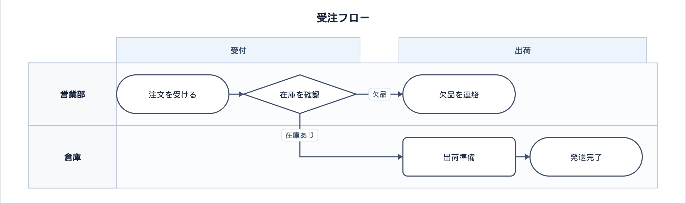

# Swimlane Diagram Preview

[English](./README.en.md) | **日本語**

VS Code の標準Markdownプレビューで、` ```swimlane ` フェンスコードブロックをその場でスイムレーン図（業務フロー図）として描画する拡張機能です。Mermaidのコードブロックが標準プレビューでそのまま図になるのと同じ感覚で使えます。



上の図は、以下のようなコードブロックをMarkdownに書くだけで得られます。

```swimlane
swimlane
    title "受注フロー"
    direction LR

    lane sales "営業部"
    lane wh "倉庫"

    phase p1 "受付"
    phase p2 "出荷"

    node s1 "注文を受ける" lane=sales phase=p1 shape=start
    node s2 "在庫を確認" lane=sales phase=p1 shape=decision
    node w1 "出荷準備" lane=wh phase=p2
    node w2 "発送完了" lane=wh phase=p2 shape=end
    node s3 "欠品を連絡" lane=sales phase=p2 shape=end

    s1 -> s2
    s2 -> w1 "在庫あり"
    s2 -> s3 "欠品"
    w1 -> w2
```

## 使い方

1. この拡張機能をインストールする
2. Markdownファイル（`.md`）に ` ```swimlane ` フェンスで `.swim` 記法のコードを書く
3. プレビュー（`Ctrl+Shift+V` / `Cmd+Shift+V`）を開くと、その場で図が描画される

まずは以下をそのまま `.md` ファイルに貼り付けて試すのがおすすめです。

```markdown
​```swimlane
swimlane
    title "使用イメージ"
    direction LR

    lane you "あなた"
    node n1 "```swimlane を書く" lane=you shape=start
    node n2 "プレビューを開く (Ctrl+Shift+V)" lane=you
    node n3 "図が見える" lane=you shape=end

    n1 -> n2
    n2 -> n3
​```
```

構文エラーがある場合は、図の代わりにエラー内容（何行目のどこが問題か）がプレビュー上に表示されます。

手で書くのがつらい場合は、[Swimlane GUI Studio](https://tossie85.site/tools/swimlane-gui-studio.html) のGUIで組み立てて `.swim` を書き出し、貼り付けて使うこともできます。

## `.swim` 記法

`.swim` は行ベースの簡易な記法です。行の前後の空白は無視されます。

- `swimlane` — 先頭行の目印（あってもなくても解析結果は変わりません）
- `# コメント` — `#` から始まる行はコメントとして無視されます
- `title "タイトル"` — 図のタイトル（省略可）
- `direction LR` / `direction TB` — 図の向き。`TD` は `TB` の別名として扱われます。省略時は `TB`

属性値（`lane=` / `phase=` / `shape=` / `color=` など）は空白で区切られたトークンとして解析されるため、値の中に空白を含めることはできません。

### lane（レーン）

```
lane <id> "<ラベル>" [#RRGGBB]
```

| 項目 | 説明 |
|---|---|
| `<id>` | レーンを識別するID。`node` の `lane=` から参照する。必須 |
| `"<ラベル>"` | レーン名。省略時は `<id>` がそのまま表示名になる |
| `#RRGGBB` | レーンの背景色（16進カラーコード、`#RGB`〜8桁まで可）。省略可 |

### phase（フェーズ）

```
phase <id> "<ラベル>"
```

レーンを横断する区切り（工程・時系列など）を表します。1つも定義しない場合、図全体が単一フェーズとして扱われます。

| 項目 | 説明 |
|---|---|
| `<id>` | `node` の `phase=` から参照するID。必須 |
| `"<ラベル>"` | フェーズ名。省略時は `<id>` がそのまま表示名になる |

### node（ノード / 図形）

```
node <id> "<ラベル>" [lane=<laneId>] [phase=<phaseId>] [shape=<shape>] [color=#RRGGBB]
```

| 項目 | 説明 |
|---|---|
| `<id>` | 接続（edge）から参照するID。必須 |
| `"<ラベル>"` | ノード内に表示するテキスト。`shape=startdot` / `enddot` のときは省略可 |
| `lane=` | 所属するレーンのID。省略時は先頭のレーンに属する |
| `phase=` | 所属するフェーズのID。省略可 |
| `shape=` | 図形の種類。省略時は `process` |
| `color=` | ノードの塗り色（16進カラーコード）。省略可 |

`shape=` に指定できる値:

| 値 | 形状 |
|---|---|
| `process`（既定） | 四角（処理） |
| `start` | 角丸（開始） |
| `end` | 角丸（終了） |
| `decision` | ひし形（判断） |
| `io` | 平行四辺形（入出力） |
| `startdot` | ●（開始点。状態遷移図の `[*]` に相当し、他の図形より小さく描画） |
| `enddot` | ◉（終了点） |

### edge（接続）

```
<fromId> -> <toId> ["<ラベル>"]
<fromId> --> <toId> ["<ラベル>"]
```

| 記法 | 意味 |
|---|---|
| `->` | 実線の矢印 |
| `-->` | 破線の矢印 |
| `"<ラベル>"` | 接続線上に表示するテキスト。省略可 |

`<fromId>` / `<toId>` は `node` で定義した `<id>` を参照します。未定義のIDを指定した場合や、`lane=` / `phase=` が未定義のIDを参照している場合は、プレビュー上にエラーとして表示されます。

## しくみ

VS Codeの `markdown.markdownItPlugins` 拡張ポイントを使い、標準プレビューが使っている `markdown-it` の fence レンダラーを横取りしています。`swimlane` 言語のフェンスだけを [swimlane.js](https://tossie85.site/assets/swimlane.js)（外部依存ゼロの描画ライブラリ）でSVGに変換し、それ以外の言語は通常どおり（シンタックスハイライト等）に描画します。

`swimlane.js` はDOMに依存せず解析・レイアウト計算・SVG生成ができる作りになっているため、Webview側で追加のスクリプトを実行する必要がなく、拡張機能ホスト（Node.js）側で同期的に変換しています。

## ライセンス

MIT License. 外部通信は一切行いません。
